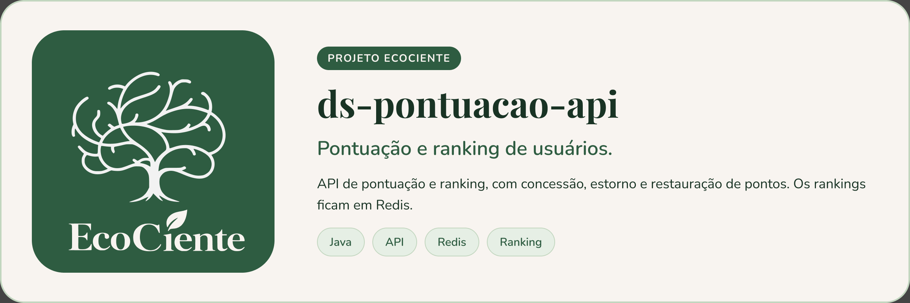

<p align="center">
  
</p>

# API de Pontuação (ds-pontuacao-api)


> API REST do EcoCiente que consolida a pontuação de moradores (postagens de reciclagem e quizzes) e mantém os rankings de moradores e torres de cada condomínio.

## Sobre o projeto

A API `pontuacao` registra movimentações de pontos no PostgreSQL e mantém os rankings no Redis. Principais responsabilidades:

- **Consolidar pontos** de postagens e de tentativas de quiz, com chave de idempotência (`Idempotency-Key`).
- **Reconciliar** a pontuação de uma postagem.
- **Consultar** saldo e movimentações de um usuário.
- **Rankings** de moradores e de torres por condomínio, com consulta de posição individual.
- **Validação de postagens**: decisão de síndico/admin e fechamento automático das janelas de validação (job agendado).
- **Administração do Redis**: sincronização de pendências, status e reconstrução dos rankings a partir do banco.

A autenticação é feita por token JWT (HMAC) recebido no cabeçalho `Authorization: Bearer`. O perfil do usuário vem do claim `perfil` (`ADMIN`, `SINDICO`, `SERVICE`...) e o identificador do usuário, do claim `usuarioId`.

### Endpoints

| Método | Rota | Quem acessa |
| --- | --- | --- |
| POST | `/api/v1/pontuacoes/postagens/{postagemId}/consolidar` | `SERVICE`, `ADMIN` |
| POST | `/api/v1/pontuacoes/postagens/{postagemId}/reconciliar` | `SERVICE`, `ADMIN` |
| POST | `/api/v1/pontuacoes/quizzes/tentativas/{tentativaId}/consolidar` | `SERVICE`, `ADMIN` |
| GET | `/api/v1/pontuacoes/usuarios/{usuarioId}/saldo` | o próprio usuário ou `ADMIN` |
| GET | `/api/v1/pontuacoes/usuarios/{usuarioId}/movimentacoes` | o próprio usuário ou `ADMIN` |
| GET | `/api/v1/rankings/moradores?condominioId=&limit=` | usuário com vínculo ativo no condomínio, síndico dele ou `ADMIN` |
| GET | `/api/v1/rankings/torres?condominioId=&limit=` | idem |
| GET | `/api/v1/rankings/moradores/{usuarioId}/posicao?condominioId=` | vínculo ativo no condomínio, síndico dele ou `ADMIN` |
| GET | `/api/v1/rankings/torres/{torreId}/posicao?condominioId=` | idem, e a torre precisa pertencer ao condomínio |
| PATCH | `/api/v1/postagens/{postagemId}/decisao` | `ADMIN`, ou `SINDICO` do condomínio da postagem |
| POST | `/api/v1/postagens/{postagemId}/finalizar-validacao` | `ADMIN` |
| POST | `/api/v1/admin/redis/sincronizar-pendentes` | `ADMIN`, `SERVICE` |
| GET | `/api/v1/admin/redis/status` | `ADMIN` |
| POST | `/api/v1/admin/rankings/reconstruir` | `ADMIN` |

Abertos sem autenticação: `/actuator/health`, `/swagger-ui/**` e `/v3/api-docs/**`. Qualquer outra rota é negada.

## Pré-requisitos

- JDK 21
- PostgreSQL com o schema do EcoCiente já criado (a aplicação usa `ddl-auto=validate` e **não** cria tabelas)
- Redis
- Docker (para os testes de integração com Testcontainers e para rodar a imagem)

## Instalando

```bash
git clone https://github.com/EcoCiente-Instituto-J-F/ds-pontuacao-api.git
cd ds-pontuacao-api
```

Copie o `.env.example` para `.env` na raiz (ele é ignorado pelo git e lido pelo Spring via `spring.config.import`) e preencha as variáveis abaixo:

```bash
cp .env.example .env        # Linux/macOS
copy .env.example .env      # Windows (cmd)
```

| Variável | Descrição |
| --- | --- |
| `JWT_SECRET` | Segredo HMAC dos tokens JWT, com no mínimo 32 bytes |
| `DB_URL` | URL JDBC do PostgreSQL (ex.: `jdbc:postgresql://localhost:5432/ecociente`) |
| `DB_USER` / `DB_PASSWORD` | Credenciais do banco |
| `REDIS_HOST` / `REDIS_PORT` | Endereço do Redis |
| `REDIS_USERNAME` / `REDIS_PASSWORD` | Credenciais do Redis |
| `RANKING_CYCLE_EPOCH` | Data de início do primeiro ciclo do ranking (`yyyy-MM-dd`) |
| `SERVER_PORT` | (opcional) porta HTTP; o padrão é `9786` |
| `APP_PORT` | (opcional) porta publicada pelo `docker-compose.yml`; o padrão é `8080` |

Os valores `CHANGEME` do `.env.example` precisam ser trocados antes de rodar.

O `gradle.properties` aponta o JDK para `C:/Program Files/Java/jdk-21.0.12.1`. Se o seu JDK 21 estiver em outro caminho, ajuste `org.gradle.java.home` localmente.

## Usando

Executar localmente:

```bash
./gradlew bootRun        # Linux/macOS
gradlew.bat bootRun      # Windows
```

A API sobe na porta `9786` (ou em `SERVER_PORT`). Documentação interativa: `http://localhost:9786/swagger-ui/index.html`. Health check: `http://localhost:9786/actuator/health`.

Com Docker:

```bash
docker compose up --build
```

O compose publica a porta `${APP_PORT:-8080}` (o container escuta em `8080`). O `docker-compose.yml` não define as variáveis de banco, Redis e JWT: informe-as via `environment`/`env_file` ao subir o container.

## Testes

```bash
./gradlew clean build --no-daemon
```

Esse é o comando que o CI executa. Os testes de integração (`PontuacaoIntegrationTest`) sobem PostgreSQL 16 e Redis 7 com Testcontainers, então o Docker precisa estar rodando.

## Estrutura do projeto

```text
src/main/java/br/com/ecociente/pontuacao/
├── config/          # Segurança (JWT), regras de autorização e jobs agendados
├── core/
│   ├── domain/      # Modelos de domínio
│   ├── exception/   # Exceções de negócio
│   ├── gateway/     # Interfaces de acesso a dados
│   └── service/     # Regras de negócio
├── dataprovaider/   # Entidades JPA, repositórios, mappers e gateways (PostgreSQL/Redis)
└── entrypoint/      # Controllers REST, DTOs e tratamento de erros
src/test/            # Testes unitários e de integração (+ SQL de schema e dados de teste)
scripts/pr-bot/      # Bot que gera a descrição das Pull Requests
.github/workflows/   # CI (build, imagem Docker) e PR bot
```

## Contribuindo

Leia o [CONTRIBUTING.md](CONTRIBUTING.md) antes de abrir uma Pull Request. Ao participar, você concorda com o [Código de Conduta](CODE_OF_CONDUCT.md).

## Segurança

Encontrou uma vulnerabilidade? Siga o [SECURITY.md](SECURITY.md). **Não abra issue pública.**

## Licença

Este projeto está sob a licença MIT. Veja o arquivo [LICENSE](LICENSE).
